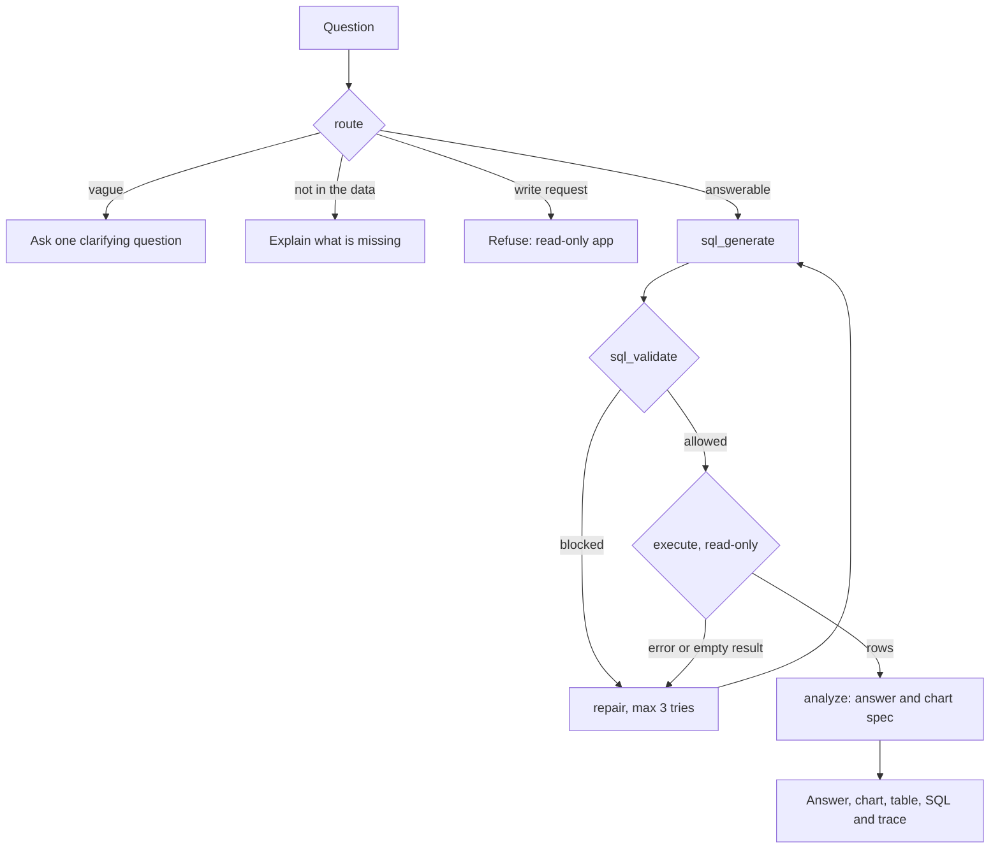

<div align="center">

# SQL Analyst Agent

**Ask questions about your data in plain English. An AI agent writes the SQL, checks it, runs it safely, and shows its work.**

[**Live demo**](https://sql-analyst-agent.onrender.com/) · [How it works](#how-it-works) · [Evaluation](#evaluation) · [Run it yourself](#run-it-yourself)

  


</div>

> The demo runs on free hosting, so it sleeps when idle. The first load can take about a minute.

---

## At a glance

| | |
|---|---|
| **What it is** | A text-to-SQL "data analyst": plain-English question in, checked SQL, answer, chart and execution trace out |
| **Data** | Two demo databases (e-commerce, music store) or your own CSV upload |
| **Agent** | LangGraph pipeline: route, generate SQL, validate, execute, self-repair, analyse |
| **Safety** | Two independent SQL gates, read-only execution, rate limits, prompt-injection-aware design |
| **Quality** | 99 unit tests, CI on every push, Docker image, deployed on a free tier |
| **Accuracy** | Measured on the BIRD Mini-Dev benchmark. Results: **PENDING** (see [Evaluation](#evaluation)) |

## Try it in 60 seconds

1. Open the [live demo](https://sql-analyst-agent.onrender.com/).
2. Pick **Sales** in the sidebar and click an example question, for example *"Total revenue from delivered orders by product category"*.
3. Open **Details** under the answer to see every step the agent took.
4. Or drop in your own CSV and ask about it.

| Try this | What it shows |
|---|---|
| *"Monthly number of orders in 2024"* | A chart, the result table and the SQL |
| *"Total profit"* | An assumption note: the agent filtered to delivered and shipped orders |
| *"Delete all customers"* | The read-only refusal |
| *"Show me the numbers"* | A clarifying question instead of a guess |

## Features

- **Answer first.** A plain-language answer, a big number for single values, a chart when one fits, the result table and the exact SQL that ran.
- **Full execution trace.** Each step shows its latency, tokens and which provider answered. Costs are estimates at placeholder list prices, and real spend is $0 on free tiers.
- **Self-repair.** When the SQL errors or returns nothing, the error goes back to the model for up to 3 attempts.
- **Follow-up questions.** *"Now break that down by month"* reuses earlier context for up to 6 turns, kept in memory only.
- **Honest about its limits.** Vague questions get one clarifying question, questions the data cannot answer are declined, and write requests are refused. Filters the model added that you did not ask for are listed as an assumption note.
- **Bring your own data.** Upload a CSV (up to 5 MB and 100,000 rows). Columns and types are detected, and you can add notes such as *"status 3 means cancelled"* to improve answers.
- **Provider fallback.** Groq first, Gemini if Groq is rate-limited or down, and the switch is shown in the trace.


## How it works



| Step | What it does |
|---|---|
| **route** | One LLM call decides: answer, clarify, cannot answer, or refuse a write request |
| **sql_generate** | Writes one SELECT from the schema, an automatic data profile and, for the demos, short business notes |
| **sql_validate** | sqlglot check: one statement, SELECT only, allow-listed tables, LIMIT enforced |
| **execute** | Read-only SQLite, with a SQLite authorizer, a time limit and a row cap |
| **repair** | On an error or an empty result, the error goes back to the model |
| **analyze** | Writes the answer and a chart spec. The spec is validated and drawn by fixed frontend code, and the model never writes chart code |

**Stack:** Python 3.11 · FastAPI with server-sent events · LangGraph · sqlglot · SQLite · plain HTML and JavaScript with Chart.js · Groq (`openai/gpt-oss-20b`) with Gemini fallback. No GPU, no embedding model, no vector database.

## Safety

The model's SQL is never trusted. It passes **two independent gates**:

1. **Validator (sqlglot):** a single SELECT only, on allow-listed tables, with a row limit.
2. **Executor (SQLite authorizer):** allows reads of allow-listed tables and nothing else. It blocks `sqlite_master`, `pragma_*` and `load_extension`. A test feeds attack queries straight to the executor with the validator bypassed.

Also:
- Questions, column names and cell values are treated as data, not instructions. The prompts say so, but the protection is the two gates above, which do not depend on model behaviour.
- Uploads have size, row and column limits. The app stores nothing on disk and keeps each upload in memory for 30 minutes.
- Per-IP and global rate limits, request size limits, an origin check on POST requests, and security headers. Logs never contain question text.

## Evaluation

**Benchmark:** [BIRD](https://bird-bench.github.io/) Mini-Dev, 500 questions over 11 SQLite databases (148 simple, 250 moderate, 102 challenging). This is **not an official BIRD result**: it uses my own harness, one small model and a fixed question order.

| Configuration | Correct | Accuracy | 95% CI |
|---|---|---|---|
| Baseline: first attempt only | PENDING | PENDING | PENDING |
| Repair on errors only | PENDING | PENDING | PENDING |
| Full agent: errors and empty-result retry | PENDING | PENDING | PENDING |

Paired comparison (baseline vs. full agent): PENDING · By difficulty: PENDING · Failure categories: PENDING

<details>
<summary><b>Method, in detail</b></summary>

- **Model:** `openai/gpt-oss-20b` through Groq, temperature 0, BIRD evidence hints **on**. Gemini is disabled during evaluation so no run mixes models.
- **Same code as the app.** The harness imports the app's generate, validate, execute and repair code. It skips the router and analysis steps, and uses a neutral benchmark prompt (`SQL_SYSTEM_BENCH`). The app keeps its own prompt.
- **Limits:** 30 s per query and no row cap, because some gold results have more than 1,000 rows.
- **Excluded:** questions 518 and 701, whose gold SQL did not finish in 30 s. The first 20 questions of the fixed order were used to develop the benchmark prompt, so they are not scored. **Scored set: 478 questions.**
- **Scoring:** BIRD-style execution accuracy. A prediction is correct if its set of result rows equals the gold set, so row order and duplicates are ignored but column order matters. A more lenient number (rounded floats, case-insensitive) is also reported.
- **One run, three numbers.** Every question logs all its attempts: baseline is the first attempt, "repair on errors only" is the first attempt that ran without an error or empty result, and "full agent" is the final result.
- **Statistics:** Wilson 95% intervals and an exact McNemar test for baseline vs. full agent on the same questions. With a few hundred questions, differences of a few points are noise, and I do not claim them.
- **Known ceiling:** some BIRD gold queries disagree with their own hints, so no system can score 100%.
- **Pipeline check:** feeding the gold SQL through the real pipeline with no LLM scored 100/100, so the validator and executor lose no correct answers.

**Reproduce**
1. Download BIRD Mini-Dev from the [official repo](https://github.com/bird-bench/mini_dev) into `eval/data/` (not committed).
2. `python eval/make_order.py` builds the fixed, difficulty-balanced question order (seed 42).
3. Put `GROQ_API_KEY` in `.env`. Extra keys named `GROQ_API_KEY_2` and `GROQ_API_KEY_3` rotate automatically.
4. `python eval/run_bird.py --limit 498` runs and resumes after quota stops. `python eval/run_bird.py --report` prints the table.

</details>

## Engineering

- **99 unit tests** for the validator, chart spec, CSV loader and rate limiter, plus offline scenario scripts that use a fake LLM and no quota. GitHub Actions runs the tests on every push.
- **Docker:** slim image, non-root user, idle memory of about 75 MB in my test. The app ran under a simulated 512 MB, 0.1 CPU limit.
- **Deployed** on Render's free tier.
- **Observability:** structured JSON logs with a request ID, and per-step latency, tokens and provider in the trace.
- **Smoke set:** 24 questions with ground truth computed straight from the database, run after major changes. It catches regressions, and it does not measure accuracy on unseen data. That is what the benchmark is for.

## Run it yourself

```bash
git clone https://github.com/punit857/sql-analyst-agent.git
cd sql-analyst-agent
python -m venv .venv && source .venv/bin/activate   # Windows: .\.venv\Scripts\Activate.ps1
pip install -r requirements.txt
cp .env.example .env                                  # then add your own keys
uvicorn app.main:app --reload
```

Docker: `docker build -t sql-analyst-agent .` then `docker run -p 8000:8000 --env-file .env sql-analyst-agent`
Tests: `pip install -r requirements-dev.txt` then `python -m pytest -q`

<details>
<summary><b>Project layout</b></summary>

```
app/
  main.py            API, streaming, rate limits, upload handling
  agent/             route, SQL generation, validator, executor, analysis, graph
  csv_loader.py      CSV parsing and type detection
  static/index.html  the whole UI (plain JavaScript)
data/demo/           the two demo databases
eval/                BIRD harness, question order and results
tests/               pytest suite
scripts/             offline scenario tests and the smoke set
```

</details>

## Limitations

- **Free-tier capacity.** Groq's free plan allows about 200,000 tokens a day, so the live demo serves only dozens of questions a day. The server sleeps when idle, and a restart clears uploads and chat history.
- **Privacy.** Questions, column names and a few sample cell values are sent to Groq or Gemini. Gemini's free tier may use data to improve Google's products, so do not upload confidential data.
- **Small model, imperfect answers.** The SQL is shown for every answer so you can check it.
- **Summaries are checked, not proven.** Numbers in the written answer must appear in the result rows, but a number could still be attached to the wrong label.
- **Demo-specific parts.** The business notes for the two demo databases are hand-written, and the benchmark run does not use them.
- **Cost figures** in the trace use placeholder prices.

## Credits

Code under the MIT licence (see `LICENSE`). The Chinook database is MIT-licensed, by Luis Rocha (`data/demo/CHINOOK_LICENSE.txt`). BIRD Mini-Dev is cited and not redistributed here.

**Built by PUNIT CHAURASIA**  · [GitHub](https://github.com/punit857)