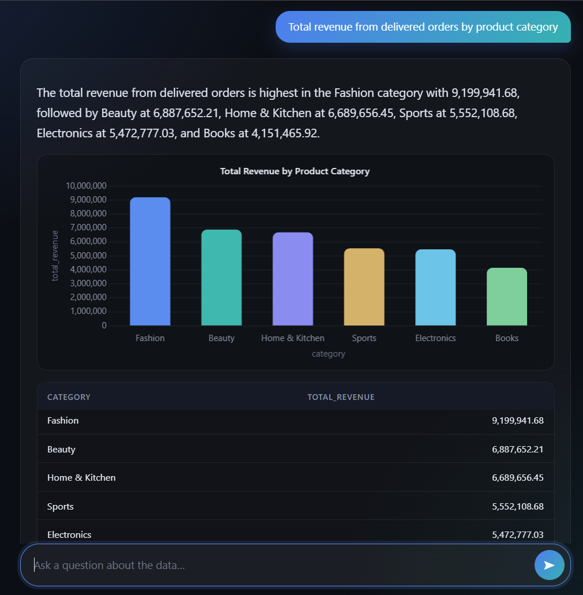
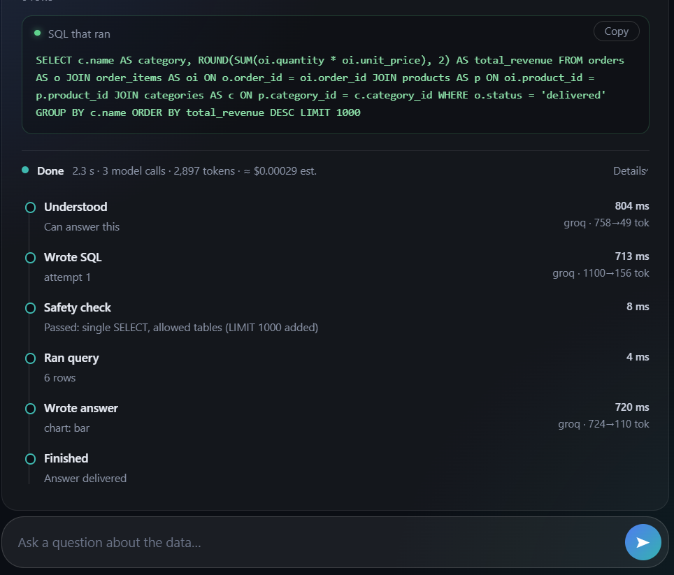
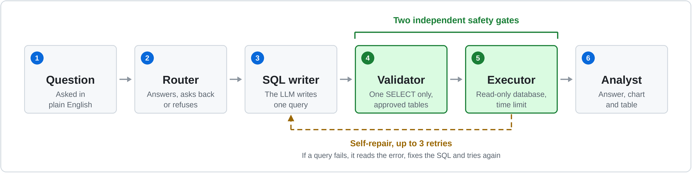
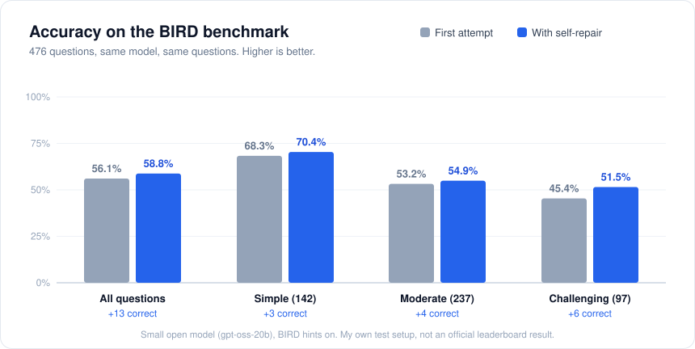

<div align="center">

# SQL Analyst Agent

**Ask questions about your data in plain English.**<br>
**An AI agent writes the SQL, checks it is safe, runs it, and shows the answer with a chart.**

[**Live demo**](https://sql-analyst-agent.onrender.com/) &nbsp;·&nbsp; [Results](#results) &nbsp;·&nbsp; [How it works](#how-it-works) &nbsp;·&nbsp; [What I learned](#what-i-learned)

     



</div>

<br>

<table align="center">
<tr>
<td align="center" width="33%"><h2>58.8%</h2>correct on a public benchmark<br>(476 questions, small open model)</td>
<td align="center" width="33%"><h2>2 safety checks</h2>on every query, so the AI<br>can only read data</td>
<td align="center" width="33%"><h2>Live</h2>deployed, tested, and<br>packaged with Docker</td>
</tr>
</table>

> The demo runs on free hosting and sleeps when nobody uses it. The first load can take about a minute.

## What it does

You ask a question like *"Which product category made the most money?"* The app:

1. works out what you mean,
2. writes the SQL and checks it is safe,
3. runs it on a read-only copy of the data, and fixes its own mistakes if the SQL fails,
4. shows a plain-English answer, a chart, the table, and the exact SQL it used.

It works on two sample databases or on a CSV file you upload. Every step is shown with the time it took, so you can see what the agent did.

<div align="center">

</div>

## What this project shows

| Area | What I did |
|---|---|
| **AI agents** | Built a multi-step agent with LangGraph that plans, writes SQL, checks it, and repairs its own errors |
| **Backend** | A FastAPI service that streams each step to the browser live |
| **Security** | Two independent safety checks, read-only data access, rate limits |
| **Testing and delivery** | Automated tests, checks on every push, a Docker image, a live deployment |
| **Evaluation** | Measured accuracy on a public benchmark with a fixed, repeatable method |

## How it works

<div align="center">

</div>

The AI is never trusted with the database. Every query it writes must pass two separate checks, and the second one still holds even if the first is bypassed:

- **A SQL checker** that allows one read-only query on approved tables.
- **A database-level lock** that permits only reading those tables and blocks everything else.

## Results

I tested the agent on [BIRD](https://bird-bench.github.io/), a public benchmark where each question has an expert-written correct answer. A question counts as correct only if the agent's result matches the expert result exactly.

<div align="center">

</div>

- **58.8%** of answers were correct with self-repair, against **56.1%** with a single attempt.
- Self-repair fixed **13 questions and broke none**.
- Almost all remaining mistakes are queries that run fine but answer the wrong thing, so retrying more would not fix them.

<details>
<summary><b>How this was measured</b></summary>
<br>

- 476 of BIRD Mini-Dev's 500 questions were scored. The rest were left out: 20 used for tuning the prompt, 2 that time out, and 2 duplicates.
- Model: `gpt-oss-20b` through Groq, with BIRD's hints turned on. This is my own test setup and a small free model, so it is **not an official leaderboard result**.
- The test uses the same agent code as the app, and one run produces both numbers: the first attempt, and the final answer after repairs.
- With this many questions, the 95% range around 58.8% is about 54% to 63%.
- BIRD's questions are public, so the model may have seen some of them during training.

To reproduce it, see `eval/` in this repository.

</details>

## What I learned

- **Testing on a public benchmark found a real bug.** An unusual query crashed my SQL checker. The same flaw was in the live app, so I fixed it there and added a test.
- **Instructions tuned for my own sample data hurt on the benchmark.** The benchmark now uses its own neutral prompt.
- **Small samples mislead.** After 85 questions the repair step looked useless. After 476 it showed a small but real gain.
- **Free tiers shape the design.** Daily limits decided how big the evaluation could be and how the live demo is rate-limited.

## Run it yourself

```bash
git clone https://github.com/punit857/sql-analyst-agent.git
cd sql-analyst-agent
python -m venv .venv && source .venv/bin/activate   # on Windows: .\.venv\Scripts\Activate.ps1
pip install -r requirements.txt
cp .env.example .env        # add your own Groq key
uvicorn app.main:app --reload
```

With Docker: `docker build -t sql-analyst-agent .` then `docker run -p 8000:8000 --env-file .env sql-analyst-agent`.

## Limitations

- It is a small model, so some answers are wrong. The SQL is shown with every answer so it can be checked.
- Free hosting means the demo sleeps when idle and serves a limited number of questions per day.
- Questions and a few sample values are sent to Groq or Gemini. Please do not upload confidential data.

---

<div align="center">

**Built by Punit Chaurasia**<br>
[LinkedIn](https://www.linkedin.com/in/punit-chaurasia-5b964727b/) &nbsp;·&nbsp; [GitHub](https://github.com/punit857)

<sub>Code is MIT licensed. The Chinook sample database is MIT licensed (Luis Rocha). BIRD is cited and not redistributed.</sub>

</div>
